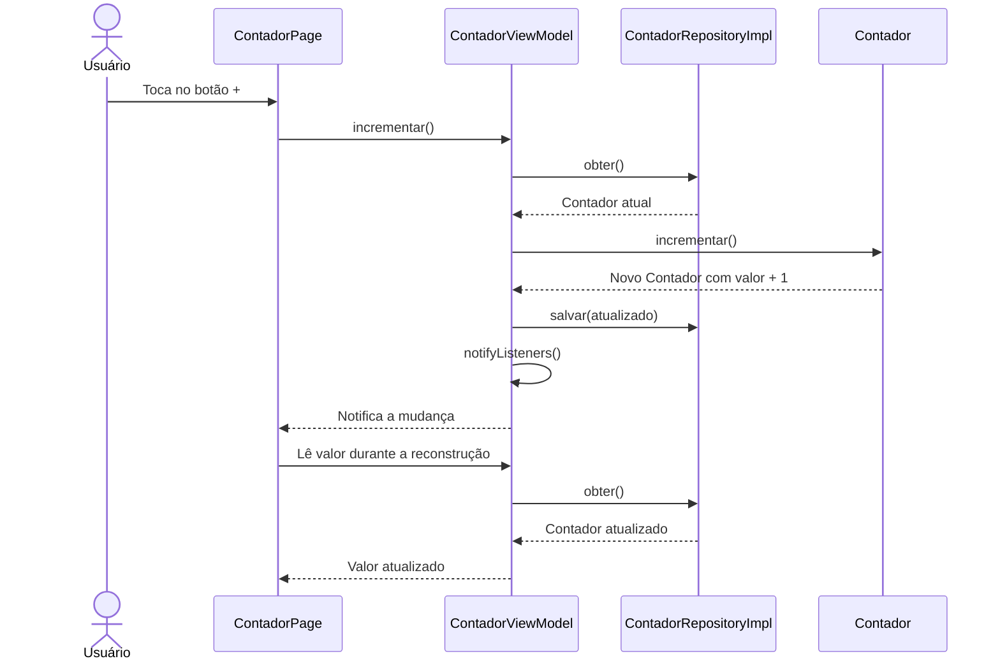

# Contador — Clean Architecture com Flutter

Projeto de estudo que usa um contador para demonstrar a separação entre domínio, dados e apresentação. A interface utiliza Flutter, e o estado é observado com Provider e `ChangeNotifier`.

## Funcionalidade

O aplicativo inicia com o valor **0**. Ao tocar no botão **+**, incrementa o contador e atualiza a tela.

O valor é armazenado apenas em memória: ao reiniciar o aplicativo, volta para zero. Não há banco de dados ou integração com APIs.

## Tecnologias

- Flutter e Dart.
- Provider (`^6.1.5+1`) para disponibilizar e observar o ViewModel.
- Material Design para a interface.

O projeto contém configurações para Android e iOS. A restrição do Dart no `pubspec.yaml` é `^3.13.4`.

## Estrutura

```text
lib/
├── main.dart
└── features/
    └── contador/
        ├── domain/
        │   ├── contador.dart
        │   └── contador_repository.dart
        ├── data/
        │   └── contador_repository_impl.dart
        └── presentation/
            ├── contador_page.dart
            └── contador_viewmodel.dart
```

### Domínio (`domain`)

Contém o objeto `Contador`, sua regra de incremento e o contrato `ContadorRepository`, com os métodos `obter()` e `salvar()`.

O contador é imutável: `incrementar()` retorna uma nova instância com o valor acrescido de um. Essa camada não depende de Flutter ou Provider.

### Dados (`data`)

`ContadorRepositoryImpl` implementa o contrato do domínio e mantém o contador em memória. Essa implementação começa com `Contador(0)`.

### Apresentação (`presentation`)

- `ContadorPage`: exibe o valor e encaminha o toque no botão ao ViewModel.
- `ContadorViewModel`: consulta o repositório, solicita o incremento ao domínio, salva o resultado e chama `notifyListeners()`.

A tela utiliza `context.watch<ContadorViewModel>()` para observar as notificações e reconstruir a interface.

### Montagem das dependências (`main.dart`)

O ponto de entrada cria `ContadorRepositoryImpl` e o injeta pelo construtor de `ContadorViewModel`. O `ChangeNotifierProvider` disponibiliza esse ViewModel para a árvore de widgets.

A apresentação depende do contrato `ContadorRepository`, enquanto a implementação em `data` também depende desse contrato. O domínio permanece independente das outras camadas.

## Fluxo do incremento



Este exemplo aplica a separação em camadas de forma simplificada. A regra de incremento está no próprio domínio; não há uma camada separada de casos de uso.

## Como executar

Tenha o Flutter instalado com uma versão de Dart compatível com o `pubspec.yaml`, além de um emulador ou dispositivo configurado. Para iOS, é necessário macOS com Xcode.

Na raiz do projeto, instale as dependências:

```bash
flutter pub get
```

Confira os dispositivos disponíveis e execute o aplicativo:

```bash
flutter devices
flutter run
```

Se houver mais de um dispositivo, escolha o destino:

```bash
flutter run -d <id-do-dispositivo>
```

## Análise e testes

Para executar a análise estática:

```bash
flutter analyze
```

O projeto ainda não contém testes automatizados. Quando forem adicionados em `test/`, poderão ser executados com:

```bash
flutter test
```

## Sugestão de leitura do código

1. `domain/contador.dart`: entenda a regra de incremento.
2. `domain/contador_repository.dart`: conheça o contrato de armazenamento.
3. `data/contador_repository_impl.dart`: veja a implementação em memória.
4. `presentation/contador_viewmodel.dart`: acompanhe a coordenação da ação.
5. `presentation/contador_page.dart`: veja como a tela observa o estado.
6. `main.dart`: entenda como as dependências são conectadas.
